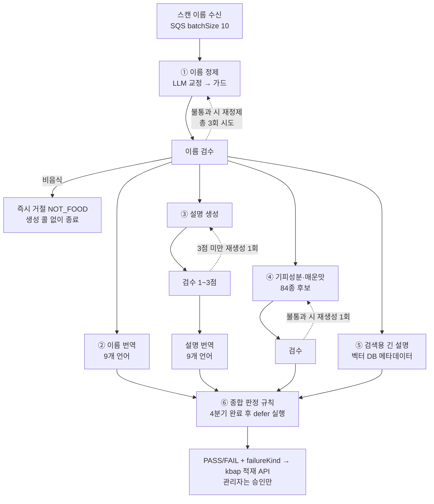

# kbap-langchain

음식 콘텐츠의 **생성과 검수를 전부 담당하는 LangGraph 파이프라인**.

kbap(Spring) 콘텐츠 배치의 LLM 로직을 이쪽으로 옮겨 없애는 것이 목표다.
이관이 끝나면 스프링에는 수집(Vision OCR)·저장·SQS 발행·관리자 승인 UI만 남고,
프롬프트·모델·평가·관측(Langfuse)은 전부 이 저장소에서 관리한다.

## 파이프라인



- **이름 검수가 입구 게이트다.** 비음식은 재정제해도 음식이 안 되므로 즉시 `NOT_FOOD`로
  끝내 생성 콜을 아끼고, 품질 불통과만 재정제 루프를 탄다(초회 포함 총 3회 시도).
- **번역은 검수하지 않는다.** 9개 언어 전수·빈 값 금지는 pydantic 경계가 보장한다.
  설명 검수는 한국어 한 줄만 보고, 통과한 설명으로만 번역을 만든다.
- **긴 설명은 판정에 참여하지 않는다.** 화면 미노출 검색 메타데이터라 검수·judge 를
  거치지 않고 join만 한다.
- **종합 판정은 LLM 이 아니라 규칙이다.** 통과 = 설명 3점 AND 기피성분 검수 통과.
  설명 미달은 `JUDGE_REJECTED`, 기피성분 불통과는 `INGREDIENT_GUARD`이며 둘 다 미달이면
  `INGREDIENT_GUARD`가 이긴다 — 알레르기 데이터는 오통과가 누락보다 위험하다.
- 재시도 후에도 실패한 분기는 사유를 그대로 안고 판정까지 흘러가 관리자가 열람한다.
  탈락 사유는 `failureKind`(NOT_FOOD / INGREDIENT_GUARD / JUDGE_REJECTED)로 구분된다.

LLM 호출 수(음식 1건):

| 경로 | 호출 |
|---|---|
| 기본(재시도 없음) — 정제·이름검수·이름번역·설명·설명검수·설명번역·기피성분·기피검수·긴설명 | **9** |
| 설명 재생성 / 기피성분 재생성 1회당 | +2 |
| 이름 재정제 1회당 (최대 2회) | +2 |
| 비음식(NOT_FOOD) 조기 종료 | 2 |

기본 9회는 `test_default_run_makes_exactly_nine_llm_calls`가 잠근다. structured output 파싱 실패 재시도(RetryPolicy)는 별도다.

## 검수 엔진 (KB-913)

검수 3곳(이름·설명·기피성분)만 엔진을 고를 수 있다. 생성·최종 판정(코드 규칙)은 엔진과 무관하다.

| 설정 | 값 |
|---|---|
| `config.yaml` `review_engine` | `llm`(기본·운영) \| `jev`(3곳 모두) \| 노드별 `description=jev`(쉼표 목록 `name\|description\|ingredients=llm\|jev`, 적지 않은 노드는 llm) |
| 환경변수 `REVIEW_ENGINE` | config 보다 우선, 같은 형식 — dev·prod 가 같은 이미지라 함수마다 따로 켤 때 쓴다. R-174 결정값은 `description=jev` |
| `TYPESAFE_API_KEY` | jev 노드가 하나라도 있으면 필수, 없으면 콜드 스타트 실패. 코드·로그·결과 파일에 남기지 않는다 |
| `config.yaml` `jev.model` / `timeout_seconds` / `max_attempts` / `policy` | 모델 버전 고정(`jev-1.14.0`), 타임아웃·재시도, 확률 임계값(보정 전 기본값은 `kbap.jev.JevPolicy`) |

Jev 판정은 PASS / REVISE / ABSTAIN 이다. 질문 문구·기준·임계값·피드백 문구는 전부 `src/kbap/jev.py` 한 곳에 있다.

| 상황 | 처리 |
|---|---|
| PASS, REVISE(사유 코드 있음) | Jev 판정 사용. 재생성 피드백은 사유 코드별 고정 문구 |
| ABSTAIN(확률이 임계값 사이), REVISE 인데 사유 코드 없음 | 기존 LLM 검수로 대체 |
| 5xx·529·연결 실패 | 재시도(`max_attempts`) 후 기존 LLM 검수로 대체 |
| timeout·429 | 재시도 후 예외 → 메시지 실패(SQS 재시도). `passed=false`·빈 성분으로 적재하지 않는다 |
| 400·401·403·413·415·422 | 재시도 없이 예외 → 메시지 실패 |

Jev 예외는 그래프 RetryPolicy 대상이 아니라 Jev 재시도 × 그래프 재시도가 곱해지지 않는다.
대체 여부·확률 원본·버전·사용량·지연은 그래프 상태 `review_traces` 에만 남고 적재 payload 에는 나가지 않는다.
재시도 없는 정상 1건은 `jev` 일 때 LLM 6회 + Jev 3회, `description=jev` 일 때 LLM 8회 + Jev 1회다.

오프라인 A/B 평가는 [`evals/decision/`](evals/decision/README.md).

## 구조

```
src/kbap/
  main.py          # 단일 진입점 — uv run kbap <cmd>, Lambda 는 kbap.main.handler
  content.py       # 본체: 콘텐츠 그래프 + 생성/검수 노드 + SQS 핸들러 + 적재 페이로드
  review.py        # 과도기: 스프링이 생성한 콘텐츠의 검수 전용 배치 (이관 완료 시 은퇴)
  namefix.py       # 이름 정제 — 파이프라인 첫 단계, content 가 재사용
  prompts.py       # 프롬프트 템플릿 전부 (소스는 Langfuse, 여기는 폴백)
  jev.py           # 검수 3곳 Jev 구현 — 질문·임계값·사유 코드·대체 정책 (KB-913)
evals/decision/                    # 검수 엔진 오프라인 A/B 평가 도구
scripts/upload_prompts.py          # 프롬프트 레지스트리 → Langfuse 최초 업로드
notebooks/content_pipeline.ipynb   # 그래프 시각화·단건 실행
config.yaml                        # 노드별 모델·타임아웃·동시성
deploy.sh                          # arm64 이미지 → ECR → Lambda 코드 업데이트
```

## 실행

```bash
uv sync
cp .env.example .env               # LLM·Langfuse·kbap 키

uv run kbap review --dry-run --limit 5      # 검수 배치 (과도기)
uv run kbap namefix --input names.json      # 이름 정제만 (디버깅)
uv run jupyter lab                          # 콘텐츠 그래프 전체 실행
uv run pytest
```

Langfuse 키가 `.env`에 있으면 음식 1건 = 트레이스 1개로 자동 기록된다.

## 배포

`./deploy.sh` — arm64 컨테이너 이미지를 빌드해 ECR `kbap/langchain` 에 `:<git sha>`·`:latest` 로
푸시하고 Lambda `kbap-generate-content`(dev)·`kbap-generate-content-prod`(prod) 코드를 SHA 태그로
갱신한다(프로필 `kbap-lambda-deployer`, CI 는 main 푸시 시 자동). 두 함수는 같은 이미지이며
환경변수 `KBAP_API_BASE_URL`·`KBAP_API_TOKEN` 만 다르다 — `config.yaml` 의 `base_url` 은 기본값(dev)이라
prod 함수에 `KBAP_API_BASE_URL` 이 빠지면 결과가 조용히 dev 로 적재된다.
prod 큐 `kbap-prod-generate-content-queue` 트리거는 2026-09-14 에 붙였다(dev 와 같은 설정) — 이제 main 푸시가 곧 prod 배포다.

롤백: `aws lambda update-function-code --function-name <fn> --image-uri 118178010621.dkr.ecr.ap-northeast-2.amazonaws.com/kbap/langchain:<이전 sha> --region ap-northeast-2`
SQS 트리거는 batchSize 10 · ReportBatchItemFailures · maxConcurrency 로 RPM을 제어한다.
메시지 계약: `{"scannedName": <str>, "foodId": <int>, "outboxId": <int>}` — foodId·outboxId 는
필수(양수)이며 적재 API 본문에 그대로 왕복된다. 위반 메시지는 그래프 실행 없이 DLQ 행.

## 운영 메모

- **기능 브랜치를 dev 에서만 확인할 때는 `./deploy.sh --dev-only`.** dev 함수(`kbap-generate-content`)만 갱신하고 prod 함수와 `:latest` 는 건드리지 않는다.

- **dev Lambda 는 수동 발행 전용이다.** dev 서버에는 콘텐츠 배치(SQS 발행)가 0대라 dev 큐에 메시지가
  자동으로 들어오지 않는다 — 검증할 때만 메시지 계약대로 직접 넣는다.
- **`kbap review` 배치는 운영 승인 경로로 쓰지 않는다.** 콘텐츠 승인은 관리자 사람 검수로 유지하며,
  이 배치는 이관 과도기의 실험·디버깅용으로만 남아 있다.

## 프롬프트 관리

프롬프트 9개의 소스는 **Langfuse(production 라벨)** 다. UI에서 수정하고 라벨을 옮기면
코드 배포 없이 반영되고, 라벨을 이전 버전으로 돌리면 롤백이다. 코드의 `*_TEMPLATE` 상수는
최초 업로드 원본이자 Langfuse 접속 불가 시 폴백이며, `{{candidate_codes}}`·`{{langs}}` 등
코드 계약이 걸린 값은 변수로 주입되므로 UI에서 편집하지 않는다.
과도기 검수 배치(`review.py`)의 프롬프트는 Langfuse 에서 제거됐고 코드 폴백으로만 돈다.
테스트는 키를 지우고 폴백 경로만 검증한다(`tests/conftest.py`).

## 남은 이관 작업

- 과도기 배치(`review.py`) 은퇴 — 생성까지 전량 이관되면 삭제
- 기피성분 정확도 필요 시: 다중 모델 합의(스프링 방식) 또는 web_search 도구
